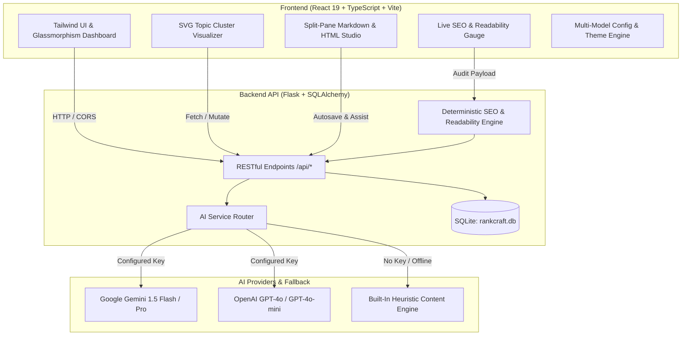

# 🚀 RankCraft AI — Autonomous Topic Clusters & Semantic SEO Engine

<div align="center">

[](https://opensource.org/licenses/MIT)
[](https://www.python.org/)
[](https://flask.palletsprojects.com/)
[](https://react.dev/)
[](https://www.typescriptlang.org/)
[](https://vitejs.dev/)
[](https://tailwindcss.com/)
[](https://ai.google.dev/)
[](#-automated-testing)

**Turn raw target keywords into complete, interconnected SEO topic clusters, reader-first pillar content, and deterministic on-page audits.**

[Features](#-key-features) • [Architecture](#-architecture) • [Quick Start](#-quick-start) • [API Reference](#-api-endpoints) • [SEO Engine](#-deterministic-seo-engine) • [Testing](#-automated-testing)

</div>

---

## 📌 Repository Description

> **RankCraft AI** is a full-stack, enterprise-grade autonomous SEO content strategy platform. It combines visual topic cluster modeling (pillar-and-spoke architecture), search-intent keyword classification, long-form editorial generation, a split-screen Markdown studio with real-time on-page SEO scoring (Flesch readability, heading hierarchy, keyword density), automated verified internal linking, and validated JSON-LD schema generation. Powered by Google Gemini and OpenAI with deterministic fallback heuristics.

---

## 🌟 Key Features

### 1. 🌐 Interactive Topic Cluster Modeling & SVG Visualizer
- **Pillar-and-Spoke Semantic Hierarchy**: Automatically plans a 1-to-many topic cluster consisting of 1 authoritative cornerstone pillar article and 5–6 supporting subtopic spoke articles.
- **Interactive SVG Cluster Canvas**: Dynamic visual graph rendering nodes, curved topical relationship paths, visual zoom/pan controls, and status rings.
- **Node Inspector Drawer**: Inspect individual cluster nodes, view target intent, and trigger one-click outline generation or long-form drafting directly from the visual map.
- **Keyword Cannibalization Safeguards**: Identifies overlapping intent between spoke pages and suggests consolidation or parent-child contextual linking.

### 2. 🎯 Search Intent & Keyword Strategy Studio
- **Multi-Dimensional Query Classification**: Maps target keywords into:
  - **Search Intent**: Informational, Commercial, Transactional, Navigational
  - **Funnel Stage**: TOFU (Top of Funnel), MOFU, BOFU
  - **User Core Problem**: The direct query and friction point the visitor needs resolved
  - **Optimal Format**: Pillar Guides, Comparison Tables, Pricing Breakdowns, Local Service Pages
  - **Editorial Angle**: Unique perspective to stand out against generic SERP competitors
- **Zero Hallucination Safeguard**: Strictly refuses to generate fake monthly search volumes or fabricated keyword difficulty scores without verified API connections.

### 3. 📝 Structured SEO Blog Outline Generator
- Creates comprehensive, human-first article blueprints before drafting:
  - Meta title and target H1
  - Search intent and primary audience persona
  - Hierarchical H2 sections and H3 sub-points with targeted word counts
  - Direct answers to common user questions (People Also Ask)
  - Practical, realistic real-world application examples (no fabricated case studies)
  - Contextual call to action (CTA) recommendations
- Fully interactive: Add, reorder, delete, and edit sections inline, then convert into a draft with one click.

### 4. ✍️ Long-Form AI Article Generator
- **Multi-Depth Generation Options**:
  - **Short**: ~600 words (direct informational / transactional queries)
  - **Standard**: ~1,000 words (in-depth authoritative guide)
  - **Detailed Pillar**: ~1,500+ words (cornerstone semantic resource)
- **Complete Publication Pack**:
  - Optimized SEO Title & clean URL slug
  - Character-validated Meta Title (50–60 chars) & Meta Description (135–165 chars)
  - Strict single-H1 Markdown article body
  - Natural FAQ section addressing conversational search intent
  - Descriptive image placement concepts with accessibility & SEO alt text
  - Internal link placements targeting verified website pages
  - Validated JSON-LD structured data (`Article`, `BlogPosting`, `LocalBusiness`)

### 5. 🎨 Split-Screen Content Studio & AI Writing Assistant
- **Split-Pane Editor**: Real-time side-by-side Markdown source editor and styled rich HTML reader preview.
- **Markdown Toolbar**: Instant insertion of headings (H1–H3), bold, italic, blockquotes, lists, code blocks, and hyperlinks.
- **Live Metrics Counter**: Real-time word count, character count, estimated reading time, and keyword density.
- **Autosave Engine**: Continuous background persistence with visible sync status indicator.
- **Contextual In-Editor AI Assistant**: Highlight any paragraph to:
  - *Improve Clarity & Flow*
  - *Simplify Technical Jargon*
  - *Expand with Concrete Examples*
  - *Tighten & Eliminate Redundancies*
  - *Tone Down Exaggerated Claims*
  - *Strengthen Hook / Conclusion*
- **Export Capabilities**: One-click download as clean Markdown (`.md`), standalone formatted HTML (`.html`), or direct clipboard copy.

### 6. 📊 Deterministic On-Page SEO Auditor
- Instant 0–100 audit score based on objective technical standards:
  - **Title Tag Check**: 50–65 characters
  - **Meta Description Check**: 135–165 characters
  - **Single H1 Validation**: Flags missing or multiple H1 tags
  - **Heading Hierarchy**: Evaluates logical flow of H2 and H3 tags
  - **Keyword Placement**: Verifies inclusion in title, H1, opening 150 words, and subheadings
  - **Readability Formulas**: Computes exact **Flesch Reading Ease** and **Flesch-Kincaid Grade Level** scores
  - **Link Distribution & CTA Presence**: Detects internal links and conversion points

### 7. 🔗 Automated Internal Linking Recommendation Engine
- Eliminates orphan pages and builds topical authority.
- Recommends verified internal anchor text and target destinations based on your stored website inventory.
- Distributes natural, contextual link variations across cluster siblings to avoid search engine over-optimization penalties.

### 8. 📍 Local SEO Studio
- Generates geo-targeted landing page outlines, localized FAQs, neighborhood-specific blog concepts, and geo-targeted CTAs.
- Enforces strict quality standards: refuses to invent fake physical addresses, phone numbers, or fabricated customer reviews.

### 9. 🔍 SERP Snippet Preview & Validated JSON-LD Schema
- Toggle between **Google Desktop** and **Google Mobile** search result previews.
- Generates standards-compliant, error-free JSON-LD schemas (`Article`, `BlogPosting`, `LocalBusiness`, `FAQPage`) ready to inject into your CMS head tag.

### 10. 🏢 Multi-Project & Brand Voice Management
- Manage distinct client workspaces, each with dedicated target domains, audience personas, tone of voice, content guidelines, competitor URLs, and page inventories.

---

## 🏗️ Architecture



---

## 📁 Project Structure

```
AI-SEO-Blog-Content-Cluster/
├── backend/
│   ├── app.py                # Primary Flask API server & route controllers
│   ├── ai_service.py         # Gemini & OpenAI client router with safe JSON parsing
│   ├── models.py             # SQLAlchemy 2.0 ORM database models
│   ├── seo_engine.py         # Deterministic audit engine (Flesch readability, on-page score)
│   ├── test_api.py           # Pytest test suite covering endpoints & calculations
│   └── requirements.txt      # Backend Python dependencies
├── frontend/
│   ├── src/
│   │   ├── components/       # UI modules: Sidebar, Header, ClusterMap, SEOAuditor, etc.
│   │   ├── types.ts          # TypeScript interfaces for projects, articles, clusters
│   │   ├── api.ts            # Client API service communicating with Flask
│   │   ├── App.tsx           # Application root router & view switcher
│   │   ├── index.css         # Custom theme styles & typography
│   │   └── main.tsx          # React application entry point
│   ├── index.html            # Application HTML shell with modern Google Fonts
│   ├── vite.config.ts        # Vite configuration & dev server proxy
│   ├── package.json          # Frontend dependencies & scripts
│   └── tsconfig.json         # TypeScript configuration
├── .env.example              # Example environment configuration
├── .gitignore                # Comprehensive Git ignore rules (DB, keys, node_modules)
├── requirements.txt          # Root Python dependencies for one-command install
├── start.bat                 # One-click Windows launch script
└── README.md                 # Complete documentation
```

---

## ⚡ Quick Start

### Prerequisites
- **Node.js**: `v18.0.0` or higher ([Download](https://nodejs.org/))
- **Python**: `v3.10` or higher ([Download](https://www.python.org/))
- **Git**

### Installation

1. **Clone the repository:**
   ```bash
   git clone https://github.com/Anishgoswami-dev/AI-SEO-Blog-Content-Cluster.git
   cd AI-SEO-Blog-Content-Cluster
   ```

2. **Set up the Backend:**
   ```bash
   # Install Python dependencies
   pip install -r requirements.txt

   # (Optional) Set up your environment file:
   copy .env.example .env
   ```

3. **Set up the Frontend:**
   ```bash
   cd frontend
   npm install
   cd ..
   ```

---

### Running the Application

#### Option A: One-Click Startup (Windows)
Double-click `start.bat` or run:
```cmd
start.bat
```
This automatically launches both the Flask API server and Vite dev server in separate consoles.

#### Option B: Manual Startup

**Terminal 1 — Backend API:**
```bash
python backend/app.py
```
> Server runs at `http://127.0.0.1:5000` (auto-seeds a starter project if database is clean).

**Terminal 2 — Frontend Studio:**
```bash
cd frontend
npm run dev
```
> Open your browser at `http://localhost:5174` (or `http://localhost:5173`).

---

## 🔌 API Endpoints

| Method | Endpoint | Description |
|:---|:---|:---|
| `GET` | `/api/health` | Healthcheck and active database status |
| `GET` | `/api/dashboard/stats` | Aggregated project, article, cluster, and keyword metrics |
| `GET` / `POST` | `/api/projects` | List active projects or create a new business profile |
| `GET` / `PUT` | `/api/projects/<id>` | Retrieve or update a business profile and domain inventory |
| `POST` | `/api/keywords/analyze` | Classify keyword search intent, funnel stage, and content angle |
| `POST` | `/api/clusters/generate` | Generate complete pillar-and-spoke topic cluster |
| `GET` | `/api/clusters/<id>` | Retrieve cluster nodes, connections, and status |
| `POST` | `/api/outlines/generate` | Generate structured, reader-first blog outline |
| `POST` | `/api/articles/generate` | Generate full publication-ready long-form article pack |
| `GET` / `POST` | `/api/articles` | List articles or save a new editorial piece |
| `PUT` / `DELETE`| `/api/articles/<id>` | Update article content, metadata, or remove article |
| `POST` | `/api/articles/assist` | In-editor AI writing assistance on highlighted text |
| `POST` | `/api/seo/audit` | Run deterministic on-page SEO & Flesch readability evaluation |
| `GET` / `POST` | `/api/settings` | Retrieve or securely update AI model API keys and preferences |

---

## 🧮 Deterministic SEO Engine

RankCraft AI avoids subjective AI opinions by executing rigorous, formulaic on-page SEO evaluations:

### 1. Flesch Reading Ease Formula
$$\text{Score} = 206.835 - 1.015 \left(\frac{\text{total words}}{\text{total sentences}}\right) - 84.6 \left(\frac{\text{total syllables}}{\text{total words}}\right)$$
- **90–100**: Very Easy (5th-grade reader)
- **60–70**: Standard (Plain English, optimal for general audiences)
- **0–30**: Academic / Highly Technical

### 2. On-Page Health Scoring (0–100)
- **Title Tag (15 pts)**: Optimal length (50–65 characters) with primary keyword placement.
- **Meta Description (15 pts)**: Engaging preview (135–165 characters) with primary keyword.
- **Single H1 (15 pts)**: Exactly one H1 tag matching primary search intent.
- **Heading Structure (15 pts)**: Logical distribution of H2 and H3 subheadings.
- **Keyword Integration (15 pts)**: Presence in opening 150 words without stuffing (< 2.5% density).
- **Readability & Engagement (15 pts)**: Target Flesch score >= 50.
- **Internal Linking & Conversion (10 pts)**: Verified context links and actionable CTA.

---

## 🧪 Automated Testing

The backend includes a comprehensive suite of automated tests using `pytest`:

```bash
pytest backend/test_api.py -v
```

### Test Coverage Highlights:
- ✅ Healthcheck & database initialization
- ✅ Dashboard metrics calculation
- ✅ Project creation and business profile persistence
- ✅ Keyword intent mapping & funnel classification
- ✅ Deterministic SEO scoring engine & Flesch mathematical formulas
- ✅ Local SEO generator safeguards (rejection of fabricated reviews/addresses)
- ✅ Topic cluster generation & spoke node relationships
- ✅ Article save, update, and retrieval lifecycles

---

## 🛡️ Responsible AI & SEO Best Practices

1. **Zero Hallucinated Metrics**: RankCraft AI never fabricates keyword search volume, keyword difficulty, or organic traffic forecasts. Real-world volume data requires authorized search API integrations.
2. **Anti-Spam Safeguards**: Prevents thin doorway content, repetitive programmatic city-swapping, and keyword stuffing.
3. **Reader-First Editorial Quality**: Prioritizes satisfying the user's search query, resolving pain points, and answering practical questions over arbitrary word quotas.
4. **Local Accuracy**: Never generates fake customer testimonials, fictitious addresses, or fake phone numbers.
5. **Secure Key Storage**: API credentials entered in Settings are kept server-side and never leaked in client-side bundles.

---

## 👥 Contributing

Contributions, feedback, and feature suggestions are welcome!

1. Fork the Project
2. Create your Feature Branch (`git checkout -b feature/AmazingFeature`)
3. Commit your Changes (`git commit -m 'feat: Add AmazingFeature'`)
4. Push to the Branch (`git push origin feature/AmazingFeature`)
5. Open a Pull Request

---

## 📜 License

Distributed under the **MIT License**. See `LICENSE` for more information.

---

<div align="center">
  <b>Built by <a href="https://github.com/Anishgoswami-dev">Anish Goswami</a></b><br>
  <i>Empowering creators and agencies with intelligent, verified semantic SEO strategies.</i>
</div>
